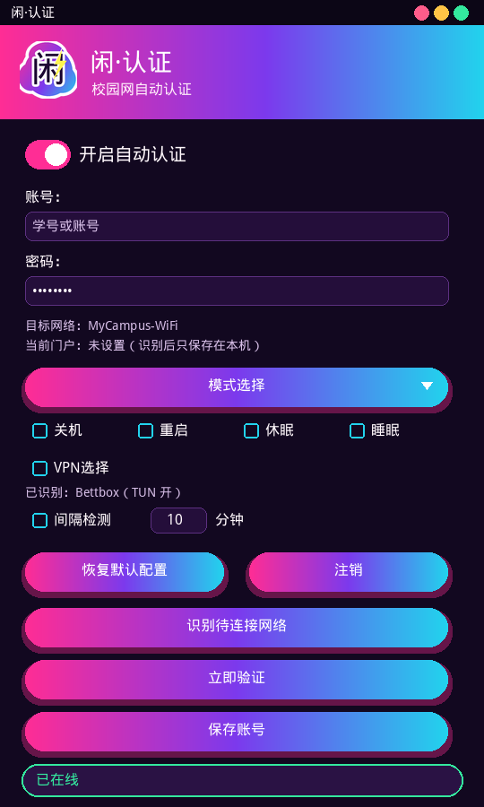

# 闲·认证（xian-renzheng）

Windows 上的校园网 / Wi-Fi 网页门户自动认证工具。设置窗口只在打开时运行；真正的认证由计划任务拉起一个无窗口进程，做完一次检查或登录就退出，不常驻、不轮询。

目标框架是 **.NET Framework 4.8**（Windows 10 / 11 自带，不需要再装运行时）。界面为简体中文。许可是 [MIT](LICENSE)。

## 功能

- 记录每次认证的耗时：系统启动（Kernel-General 12）或唤醒（Power-Troubleshooter 1）、进入桌面（Winlogon 7001）、Wi-Fi 连上（WLAN-AutoConfig 8001）和认证成功时间，算出「开机到认证成功」「进桌面到认证成功」，写进日志和 `state.json` 的 `lastTiming`，状态栏显示「上次认证：进桌面后 X 秒完成」。系统事件读不到时只记程序自己的时间，不影响认证。
- **认证时限**：默认 15 秒，可设 5–120 秒（`config.json` 的 `authDeadlineSeconds`）。触发后先等 Wi-Fi 拿到 IPv4（最多等时限的一半），之后每 1–2 秒做一次检测加认证，成功或超时即退出；超时记一条「N 秒内未完成」日志。账号密码错误立即停止，不在时限内反复重试。
- 关机、重启、休眠、睡眠、连上无线网、登录、解锁会话，以及可选的间隔触发时，先检查是否已经在线；不在线再用本机保存的门户配置登录。
- **立即验证**：马上做一次检查。请求绑定无线网卡的 IPv4；若还没上网，就用当前门户认证一次。状态条显示「已在线」「认证成功」或「失败」及原因。
- **识别自己的门户**：仓库不预置任何学校的地址。在本机用「识别待连接网络」、导入 HAR，或粘贴登录 URL，生成只含占位符的配置。
- **VPN**：给门户地址加一条不持久的主机路由，让认证走 Wi-Fi 网关；认得出格式时，再为 Bettbox、FlClash、YueLink、Clash Verge Rev、mihomo、sing-box 写入直连或路由排除。不重启 VPN，也不改 TUN 开关。
- 账号和密码用 DPAPI 加密保存在本机。日志打码。



上图是与程序布局一致的界面示意，不是在 Windows 上截的实机画面。安装包里的窗口使用同一套胶囊按钮、渐变和卡通图标。图标是带贴纸白边的卡通「闲」。

## 怎么识别自己的门户

仓库里没有某一所学校的 SSID、门户主机或 AC 名称。请在自己的电脑上生成配置，不要把真实参数提交进仓库。

1. 打开「闲·认证」，先填写账号和密码。生成配置时口令会换成 `{password}`。
2. 点「识别待连接网络」。程序只读取登录请求的 URL、方法和参数形状，**不读取 cookie**，结果只留在本机。
3. 在弹出的浏览器里完成一次门户登录。若已经在线、页面上没有登录请求，先注销再登录一次。
4. 点「完成识别」。浏览器起不来时，用「导入 HAR」或「粘贴网址」。HAR 里的 Cookie 同样不会写入配置。
5. 生成的 JSON 在安装目录的 `profiles\`，已被 `.gitignore` 排除。占位示例见 [`docs/profile-example.json`](docs/profile-example.json)（主机是 `portal.example.edu`，SSID 是 `MyCampus-WiFi`）。

Dr.COM 网页门户、深澜 srun、锐捷 ePortal 会按重定向 URL 选择对应插件。对不上时，识别出来的 GET / POST / PUT 模板更可靠。

## 隐私

- 不上传账号、密码、Cookie 或门户抓包。账号、配置、门户资料和日志都只在本机。
- 识别过程不调用读取 Cookie 的调试命令，也不保存 Cookie。
- 密码只出现在内存和 DPAPI 密文 `account.dat` 里。配置、模板和日志使用占位符，或把口令打成 `user_password=***`。
- 卸载默认**保留**账号、配置和门户资料；只有在卸载程序里选择删除时才会清掉。卸载仍会先撤销本程序改过的 VPN 规则和主机路由。

## 许可

[MIT License](LICENSE)。Copyright (c) 2026 xian-renzheng contributors.

下面是安装、触发条件和协议形状的详细说明。

## 功能细节

- 两个程序：
  - `XianAuth.exe`：设置界面。需要管理员权限，用来保存账号、注册或删除计划任务、修改 Clash 规则、识别门户。
  - `XianAuthCore.exe`：无窗口工作进程。由任务计划程序在触发时启动，完成一次认证后退出。同一时间只允许一个实例。
- 开启「开启自动认证」后会注册计划任务，并提示：开启后将默认一直开启，手动关闭可停止使用。关闭开关会删掉这些任务。
- 账号和密码用 Windows DPAPI（本机范围）加密，写在安装目录的 `account.dat`。文件权限只留给 SYSTEM 和管理员，因此以 SYSTEM 运行的计划任务可以解密。日志里不会出现密码。
- 模式选择：
  - **关机**：冷启动后认证。
  - **重启**：重新启动后认证。
  - **休眠**：从休眠（S4）恢复后认证。
  - **睡眠**：从睡眠（S3）或现代待机恢复后认证。
  - 只要总开关开着，还会在**连接到无线网络**、**用户登录**和**解锁会话**时再跑一次。
- **立即验证**：立刻做一次连通性检查。请求绑定无线网卡的 IPv4；若还没上网，就用当前门户配置认证一次。状态条会显示进度，以及「已在线」「认证成功」或「失败」和原因。日志仍会打码。
- **VPN选择**：先给门户地址加一条不持久的主机路由，让认证流量走 Wi-Fi 网关，绕过 TUN 自动路由；同时在认得出格式的客户端里写入直连或路由排除，并备份原文件。会识别 Bettbox、FlClash、YueLink、Clash Verge Rev、mihomo 和 sing-box，以及同布局的改版客户端。不重启 VPN，也不改 TUN 开关。认证和连通性检查始终绑定无线网卡的 IPv4。
- **间隔检测**：按设定的分钟数重复触发计划任务。每次仍然是启动、检查、退出，进程里没有定时循环。
- **恢复默认配置**：按变更记录把本程序改过的计划任务、VPN 规则和由本程序新建的快捷方式放回去。已保存的账号仍留在本机。
- **注销**：确认框写着「将会断掉当前校园网的认证」，5 秒内不点确认就自动取消。
- **识别待连接网络**：用临时配置启动 Edge 或 Chrome 的远程调试端口，读一次登录请求的 URL、方法和参数形状，归类为 GET、单 POST、双 POST 或 PUT，并生成只含占位符的门户配置。也可以导入 HAR，或粘贴一条登录 URL。不读取、不保存 Cookie。
- 每个按钮都有按下变色、处理中状态，处理过程中忽略重复点击，并用底部色条显示成功或失败。

## 安装目录里有什么

默认装到 `C:\Program Files\XianRenzheng`：

| 路径 | 内容 |
| --- | --- |
| `XianAuth.exe` / `XianAuthCore.exe` | 界面和工作进程 |
| `logs\` | 按天滚动的日志，超过约 512 KB 会切开，14 天前的会删 |
| `account.dat` | DPAPI 加密后的账号和密码 |
| `配置变更记录.json` | 本程序改过的任务、文件和快捷方式，以及回滚用的备份名 |
| `backups\` | 被改写文件的原件 |
| `profiles\` | 本机门户配置。仓库不附带具体校园网参数，识别或手填后只写在这台电脑上 |
| `config.json` / `state.json` | 开关、认证时限和上次结果（含 `lastTiming`），不含密码 |
| `xian-auth.ico` / `xian-auth.png` | 图标 |

安装程序会在桌面和开始菜单放「闲·认证」快捷方式。卸载时先执行 `XianAuthCore.exe --rollback`，把本程序改过的 VPN 规则和主机路由放回去。账号、配置和门户资料默认保留；卸载程序会询问是否删除，默认选「否」。从旧版本升级时，安装程序会先把这些文件拷出来，避免旧的卸载程序把它们删掉，装完再拷回去。

## 安装

1. 从 [GitHub Actions 的构建产物](../../actions) 或 [Release](../../releases) 下载 `XianRenzheng-Setup-0.3.0.exe`，或以压缩包 `XianRenzheng-0.3.0-win.zip` 解压后直接运行。
2. 安装程序和设置界面都会请求管理员权限。计划任务要以 SYSTEM 注册，加密文件也要能被 SYSTEM 读到。
3. 打开「闲·认证」，填写账号和密码，点「保存账号」。
4. 按需要勾选关机、重启、休眠、睡眠、VPN 和间隔检测。
5. 打开「开启自动认证」。确认提示后，程序会注册计划任务；若桌面还没有快捷方式，会补一个。

压缩包方式不会自动写开始菜单。第一次打开总开关时，如果桌面没有快捷方式，程序会创建一个，并记入变更记录，恢复默认配置时可以删掉这一个。安装程序创建的快捷方式由安装程序自己卸载。

## 使用

总开关打开之后，下面这些情况会各跑一次 `XianAuthCore.exe`：

| 触发 | 计划任务 | 工作进程怎么决定要不要认证 |
| --- | --- | --- |
| 关机后的冷启动 | `XianAuth-Boot`，开机延迟 20 秒 | 读系统日志里最近一条 User32 1074。类型是关机才继续 |
| 重启 | 同上 | 1074 里出现「重新启动」才继续 |
| 睡眠 / 休眠恢复 | `XianAuth-Resume` | 订阅 Power-Troubleshooter 1 和 Kernel-Power 107。再用 Kernel-Power 42 的 TargetState / EffectiveState 区分：4 或原因码 6、13 视为休眠，1–3 视为睡眠。快速启动（混合关机）在恢复状态是休眠、且上次关机类型是关机时，按「关机」处理 |
| 现代待机恢复 | `XianAuth-Sleep` | Kernel-Power 507，只在勾了「睡眠」时注册 |
| 连上无线网络 | `XianAuth-Wlan` | WLAN-AutoConfig 操作日志的事件 8001。该日志若被关掉，这条触发不会出现，开机和解锁仍然有效 |
| 用户登录 | `XianAuth-Logon` | 登录触发，不加延迟，输入 PIN 进桌面后立刻开始 |
| 解锁会话 | `XianAuth-Unlock` | 会话解锁，不加延迟 |
| 间隔检测 | `XianAuth-Interval` | 重复触发，默认每 10 分钟，可在 1–720 分钟之间改 |

每次运行都会：

1. 用 Native WLAN API（`wlanapi.dll`）读真实 SSID。不是目标网络就不提交账号密码。若系统里已有同名的无线配置文件，会尝试连接一次。
2. 等到这块无线网卡拿到非 169.254 的 IPv4。
3. 把 `http://www.msftconnecttest.com/connecttest.txt` **绑定到这块网卡的 IPv4** 去请求。只有 HTTP 200、没有重定向、正文恰好是 `Microsoft Connect Test` 才算已经在线。正文多一个换行也不算在线，以免把门户页面当成成功；这种情况下会继续认证，门户若返回「已经在线」也会当作成功。
4. 按本机保存的 SSID 和重定向 URL 选择门户配置。仓库里没有预置某一所学校的地址；请用界面填写，或用「识别待连接网络」在本机生成。
5. 最多 4 次尝试，各次开始前等待 0 / 15 / 35 / 70 秒，总预算约 150 秒。密码错误、账号不存在这类结果不会在同一次运行里重试。连续失败达到 2 次后，后面的自动运行会直接停下，避免把账号锁住；重新保存密码会把计数清零。

自动触发不再使用上面的固定重试表，而是按「认证时限」执行：先等目标 Wi-Fi 拿到 IPv4，最多等时限的一半；之后每 1–2 秒做一次「检测 + 认证」，直到成功、账号被拒或超时。超时写一条「N 秒内未完成认证」日志后退出。手动「立即验证」仍是一次性检查，不受时限限制。

### 认证耗时

每次认证成功时记录这些时间点，写进日志和 `state.json` 的 `lastTiming`：

- 系统启动：Kernel-General 12；唤醒：Power-Troubleshooter 1（取较晚的一个）。
- 进入桌面：Winlogon 7001；读不到时退回 `XianAuth-Logon` / `XianAuth-Unlock` 的最近运行时间。
- Wi-Fi 连上：WLAN-AutoConfig 8001。
- 认证成功：程序自己记录的时间。

由此算出 `bootToAuthSeconds` 和 `desktopToAuthSeconds`。任何一项事件读不到都只留空，不报错；界面状态栏会显示「上次认证：进桌面后 X 秒完成」，读不到桌面时间时退回开机时间。

只有开机、登录、唤醒、睡眠恢复、连上无线网、解锁这几种触发记录耗时，并且必须真的提交了凭据、认证成功。注销、手动「立即验证」和间隔检测都不记录：它们没有「从开机或进桌面算起」的起点；本来就在线（`AlreadyOnline`）时也不记，避免把上一次真实认证的耗时冲掉。进桌面到认证超过 30 分钟的起点会被丢弃，防止间隔检测读到当天早上的登录事件后算出几小时的荒谬值。

注销只在当前 SSID 就是目标网络时发送，并且只做短重试。

### Dr.COM ePortal（通用插件）

没有写死某一所学校。门户主机、端口、AC 名称、账号前缀都来自本机配置或一次识别结果。示例（请换成你自己的门户，不要把真实参数提交进仓库）：

- 基准地址：`http://portal.example.edu/eportal/`
- 登录：`GET http://portal.example.edu/eportal/?c=Portal&a=login&...`
- `user_account` 由前缀加账号组成，例如前缀 `,0,` 或 `,b,`
- 无线 MAC 许多门户接受 `000000000000`；也可以在配置里改
- `wlan_ac_name` 示例：`example-ac`
- 目标 SSID 示例：`MyCampus-WiFi`
- 注销：`GET ...?c=Portal&a=logout&...`
- JSONP 里 `result=1` 是成功。`result=0` 且 `ret_code` **恰好**为字符串 `"2"` 或整数 `2` 表示已经在线。`"20"`、`"200"`、`20`、`200` 都不是。判断用的是 JSON 标记类型，不用前缀或 `Contains`。
- 带 `c=main&a=login` 的地址是门户后台，程序不会拿它做上网认证。

识别到 `c=Portal&a=login` 或 `/eportal/portal/login` 时，会按该 URL 的主机、端口和查询参数生成一份只保存在本机的配置。查询里如果已经有 `,b,` 这类前缀，会原样保留。

另外内置了两类可自动选中的认证器，供重定向 URL 对得上时使用：

- **深澜 srun**：先 `get_challenge`，再按门户页面的 xEncode、HMAC-MD5 和 chksum 登录。
- **锐捷 ePortal**：先 `pageInfo` 取公钥，密码按无填充 RSA 加密后 `POST method=login`。

这两类学校差异很大。对不上时不要依赖它们，用识别、HAR 或粘贴 URL 生成模板。模板支持 GET、单 POST、双 POST（先取令牌再提交，第一步可以是 GET）和 PUT，占位符有 `{account}`、`{password}`、`{ip}`、`{mac}`、`{mac_zero}`、`{timestamp}`。

## 识别待连接网络

点按钮后先出现这句说明：

> 请打开网页认证页面并开启F12开发者模式，本程序会自动读取相关网页内容，一切数据仅存在本机，cookie不会读取

确定之后，程序会用一块临时用户目录启动 Edge（没有则用 Chrome），带上 `--remote-debugging-port` 和 `--remote-allow-origins=*`，并打开连通性检测地址，方便门户把浏览器重定向到登录页。调试协议只订阅请求的 URL、方法、正文和少量响应正文，用来判断参数形状；Cookie、Set-Cookie 头不会写入配置。请先在主窗口填好账号和密码，这样生成文件时才能把口令换成 `{password}`。若检测发现明文密码还在，会拒绝保存。

已经在线时，页面上可能没有登录请求。先注销再登录一次。浏览器起不来时，用「导入 HAR」或「粘贴网址」。HAR 里的 Cookie 字段同样不会进入配置。

若请求是 Dr.COM 的 `c=Portal&a=login`，会生成本机配置，而不是去访问带验证码的后台地址。生成的 JSON 只放在安装目录的 `profiles\`，并且已被 `.gitignore` 排除。

## VPN 改动与回滚

勾选「VPN选择」会提示：开启后，将更改此电脑的相关VPN配置，保障网络认证走直连。

程序会在这些位置查找配置（只改当前 Windows 用户能看到的那一份）：

- Clash Verge Rev：`%AppData%\io.github.clash-verge-rev.clash-verge-rev\profiles.yaml`，以及旧版 `clash-verge` 目录。给每个本地/远程订阅挂上规则扩展；新建或改写的扩展文件形如：

```yaml
prepend:
  - IP-CIDR,10.0.0.1/32,DIRECT,no-resolve
append: []
delete: []
```

  订阅更新不会盖掉这份扩展。已有自己的规则扩展时，只把同一条规则插进 `prepend`，不替换原有规则。
- Clash for Windows：`%UserProfile%\.config\clash\config.yaml` 和 `profiles\*.yaml` 的顶层 `rules:`。
- mihomo：`%UserProfile%\.config\mihomo\config.yaml`。

改之前把原文件复制到 `backups\`，并写进 `配置变更记录.json`。取消勾选或「恢复默认配置」会按记录把原文件拷回去，并删掉本程序新建的规则文件。

不会切换 TUN，也不会改系统代理开关。Fake-IP 段 `198.18.0.0/15` 不会被写成直连目标。Clash Verge 有时要重新点一次当前订阅，扩展规则才会进到正在运行的核心。

无论是否勾选 VPN，连通性检查和认证请求都绑定无线网卡 IPv4，并绕过系统 HTTP 代理。TUN 在路由层截流量，只加代理绕过名单不够。

## 隐私

- 不上传账号、密码、Cookie 或门户抓包。账号、配置、门户资料和日志都只在本机。
- 密码只出现在内存和 DPAPI 密文里。配置文件、门户模板和日志使用占位符或 `user_password=***` 这类脱敏。
- 识别过程不调用读取 Cookie 的调试命令。
- `配置变更记录.json` 和 `backups\` 里可能有 Clash 订阅文件的原文（含订阅地址）。它们在安装目录下。卸载默认保留；只有选择删除本机数据时才会清掉。

## 资源占用

没有托盘图标，没有 Windows 服务，也没有一直醒着的定时器。界面进程随窗口关闭而结束。工作进程是 WinExe，任务运行时不会弹出控制台；计划任务允许多个实例的策略是「忽略新实例」，进程内还有一把全局互斥锁，几个触发同时到达时只跑一次。一次自动运行最多持续「认证时限」加上最后一次请求的超时，默认 15 秒；间隔检测只是任务计划程序再次启动它。

## 开发

```bash
dotnet test tests/XianAuth.Tests/XianAuth.Tests.csproj -c Release
```

单元测试覆盖 JSONP 的 `result` / `ret_code` 精确匹配、请求分类、连通性判断、触发策略、Clash 规则文本、深澜和锐捷的纯计算向量。测试项目是 `net8.0`，可以在没有 .NET Framework 的环境里跑。两个 exe 和 WinForms 界面需要在 Windows 上编译，仓库里的 GitHub Actions（`windows-latest`）会跑测试、发布 zip，并用 Inno Setup 打安装包。

本地打发布目录：

```powershell
dotnet publish src/XianAuth/XianAuth.csproj -c Release -o publish
dotnet publish src/XianAuthCore/XianAuthCore.csproj -c Release -o publish
```

## 参考与致谢

协议按公开的门户行为和下面这些资料重新实现，没有把 GPL 项目的源码抄进本仓库。本仓库使用 MIT 许可。

- Dr.COM 网页门户的 `c=Portal&a=login` JSONP、`result=1` 成功、`ret_code` 恰好为 2 表示已经在线，是这类门户的公开行为。具体主机、AC 名称和账号前缀只存在于使用者本机。
- [Senquan007/Wxxy_network_auto_login](https://github.com/senquan007/wxxy_network_auto_login)：Dr.COM ePortal 的 GET JSONP，`result=1` 为成功，`ret_code=2` 表示 IP 已经在线。
- [广东工业大学 WLAN 认证脚本](https://gist.github.com/ricky8955555/d7a2388f79f49ef322f45dfb1f2bda30)：`user_account` 使用 `,0,<账号>` 这一常见写法。
- [东南大学 Dr.COM 网关 Web 认证报文分析](https://heary.cn/posts/%E4%B8%9C%E5%8D%97%E5%A4%A7%E5%AD%A6DrCOM%E7%BD%91%E5%85%B3Web%E8%AE%A4%E8%AF%81%E6%8A%A5%E6%96%87%E5%88%86%E6%9E%90/)：`/eportal/?c=Portal&a=login` 的参数形状。
- [C01in-0/AHU_AutoLogin](https://github.com/C01in-0/AHU_AutoLogin)：把「已经在线」和「认证被拒绝」分开记录。
- [tongyifan/tju-srun-login](https://github.com/tongyifan/tju-srun-login)（MIT）：深澜先取 challenge，再用 xEncode、HMAC-MD5 和 chksum 登录。这里按门户脚本重新实现，并用固定向量对上结果。
- 锐捷 ePortal 的 `pageInfo` + `InterFace.do?method=login` 字段，参考了公开的流程说明（例如 [SWUOSA/ruijie-authentication](https://github.com/SWUOSA/ruijie-authentication)、[Barabama/RuijieEportal](https://github.com/Barabama/RuijieEportal)、[lololowe/ruijie-auto-login](https://github.com/lololowe/ruijie-auto-login)）。这些仓库多为 GPL，本程序没有复制它们的源码。
- [Clash Verge Rev 的规则扩展文档](https://www.clashverge.dev/guide/extend.html)：订阅级 `prepend` / `append` / `delete` 规则文件。
- Windows NCSI 的 `http://www.msftconnecttest.com/connecttest.txt`，以及 Native WLAN API、任务计划程序、DPAPI。

经典的 UDP Dr.COM 客户端（例如 drcom-generic）和这里的网页门户不是同一套协议，所以没有采用。

## 还没在这套环境里完成的事

- 构建代理是 Linux，不能在这里把 WinForms 窗口跑起来，所以上面的图是布局示意。可执行文件和安装包由 Windows 上的 GitHub Actions 生成。
- 没有对某个真实校园网做在线登录。Dr.COM 的 URL 形状和 `ret_code` 判断用占位参数锁在单元测试里；主机、端口和 AC 名称由本机配置提供。
- 深澜、锐捷的加密步骤有测试向量，但不同学校的 `ac_id`、运营商后缀和 RSA 是否把 MAC 拼进口令并不一致。识别出来的模板更可靠。
- Clash 规则写进扩展文件后，Verge 不一定立刻热加载；需要的话在客户端里重新启用当前订阅。程序不会为了生效去重启核心或打开 TUN。
- 关机和重启的区分依赖事件日志文本。1074 缺失时，开机触发只在勾了「关机」时继续，避免把一次不明开机当成重启。
